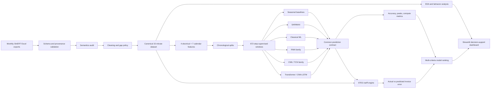
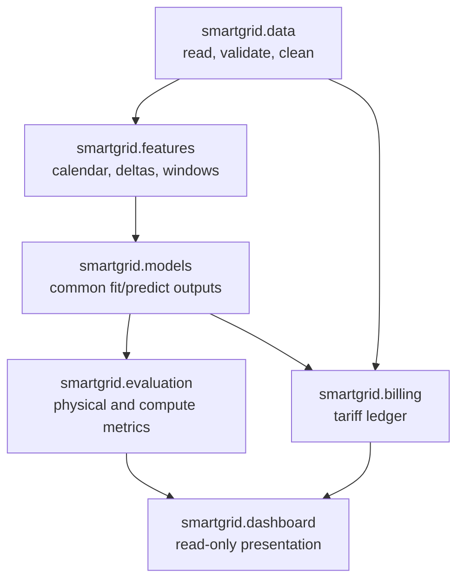
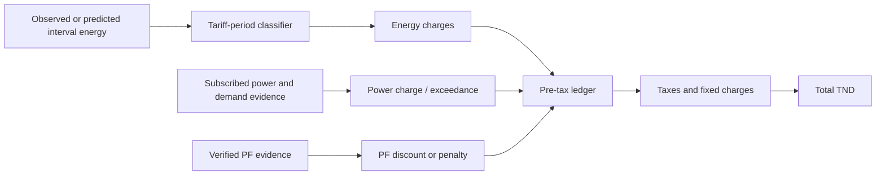

# SUP'COM Smart Grid AI - Project 2

> **Project plan and engineering architecture**
>
> *Evaluation approfondie, Benchmark multi-criteres et Modelisation IA pour la prediction energetique et l'estimation de la facturation de SUP'COM*

This repository is the implementation workspace for Project 2 of the SUP'COM Smart Grid assignment. Its purpose is to turn monthly SInERT exports into a reproducible forecasting benchmark, a verified STEG billing comparison, and an interactive decision-support dashboard.

The repository is currently at the **foundation milestone (approximately 10%)**: the plan, architecture, package skeleton, stable data/model contracts, privacy rules, and initial tests exist. Data-dependent work deliberately waits for the first real Excel export.

## 1. Current state

| Area | State | Evidence / next gate |
|---|---|---|
| Scope and architecture | Done | This README; official requirements traced to PDF pp. 5-8 |
| Repository foundation | Done | Python package, module boundaries, ignores, tests |
| Stable contracts | Done | 15-minute cadence, 672-step context, 11 inputs, 4 targets |
| Raw-data ingestion | Blocked by data | Inspect one real workbook before defining column mappings |
| EDA and cleaning | Not started | Starts after ingestion audit |
| Forecasting benchmark | Not started | Starts with `t-96` and `t-672` baselines |
| STEG billing | Planned | Validate the supplied September 2026 invoice first |
| Dashboard | Planned | Built only after metrics and billing APIs stabilize |

The percentage is a planning estimate, not a performance claim. No model has been trained and no experimental result is claimed.

## 2. Scope boundaries and decisions

### Confirmed

- Input cadence is **15 minutes** (96 samples/day).
- Initial raw working schema is `timestamp`, `Ea`, `Er`, `Pmax`, `Smax`.
- Model context is **672 steps** (7 days) with **11 variables** per step.
- The 11 inputs are 4 electrical variables plus 7 timestamp-derived calendar/cyclical variables.
- Deep-learning models jointly predict `delta_Ea`, `delta_Er`, `Pmax`, and `Smax`.
- Evaluation is chronological and leakage-safe; every model uses the same held-out periods.
- PF is deferred during initial ingestion, but remains required later for billing and alerts.
- Reusable logic belongs in `src/`; notebooks are for audit, EDA, and explanation.

### Open decisions - do not hard-code yet

- Whether `Ea` and `Er` are cumulative registers or interval energy.
- The reset/integration semantics of `Pmax` and `Smax`.
- Exact Excel column names, sheets, timestamp format, and meter identity.
- The final set of seven calendar features.
- Forecast horizon (`H=1`, `H=96`, or another supervisor-approved horizon).
- Availability and legitimate forecast-time use of weather variables.
- Effective STEG tariff option/rates and exact demand-exceedance inputs.

### Explicit non-goals for the initial delivery

- Live Modbus/device control, power-flow simulation, battery scheduling, RL, or DER dispatch.
- A database, microservices, Kubernetes, or a separate frontend.
- Uploading raw institutional data, invoices, account details, checkpoints, or secrets to Git.
- Selecting a model before a fair benchmark exists.

## 3. End-to-end architecture



### Package ownership



Each layer owns one type of truth. In particular, notebooks and the dashboard consume package APIs; they do not reimplement cleaning, metrics, or billing rules.

## 4. Data and prediction contracts

### Canonical table

| Field | Unit | Initial meaning | Required audit |
|---|---:|---|---|
| `timestamp` | Tunisia local time / documented timezone | Observation time | Parsing, ordering, duplicates, gaps |
| `Ea` | kWh | Active energy `[ABS]` | Cumulative vs interval; reset/rollover |
| `Er` | kvarh | Reactive energy `[ABS]` | Cumulative vs interval; reset/rollover |
| `Pmax` | kW | Maximum active demand | Integration and reset period |
| `Smax` | kVA | Maximum apparent demand | Integration and reset period |

Original values and source provenance are preserved. Derived deltas are created only after meter semantics are demonstrated from documentation and observed data.

### Supervised interface

```text
X: [N, 672, 11]
   672 = 7 days x 96 samples/day
   11  = 4 electrical + 7 known-at-forecast-time calendar features

y: [N, H, 4]
   4 = delta_Ea, delta_Er, Pmax, Smax
   H = configurable and not yet approved
```

Candidate calendar encoding for later review: sine/cosine pairs for time-of-day, weekday, and annual position, plus `is_weekend`. Academic holidays or study/vacation periods may replace a weak feature if a trustworthy calendar is available.

### Leakage controls

1. Sort and split by time before fitting any learned transformer.
2. Fit imputation/scaling on training data only.
3. Use only information available at the forecast origin.
4. Keep validation/test periods identical across models.
5. Permit historical context across a split boundary only when it would truly be known; never cross with target labels.
6. Version the cleaned dataset and record every experiment configuration.

## 5. Benchmark design

Implementation order follows increasing complexity. A later family is not started until the common data and evaluation path works end to end.

| Order | Family | Required candidates | Purpose |
|---:|---|---|---|
| 1 | Seasonal baselines | Persistence at `t-96`, `t-672` | Pipeline correctness and minimum benchmark |
| 2 | Statistical | SARIMAX + valid calendar/weather exogenous data | Interpretable seasonal reference |
| 3 | Classical ML | Random Forest, XGBoost or LightGBM, SVR | Strong tabular baselines |
| 4 | Recurrent DL | LSTM, Bi-LSTM, GRU | Sequence representation |
| 5 | Convolutional/residual DL | CNN-1D, ResNet-1D or TCN | Efficient local/multi-scale patterns |
| 6 | Attention/hybrid DL | Vanilla Transformer, CNN-LSTM | Long-range/hybrid comparison |

All DL candidates use the same four-output target contract. If six weeks cannot support fair tuning of every named architecture, coverage will be reported transparently and reduced only with supervisor agreement.

### Evaluation matrix

| Dimension | Metrics / evidence |
|---|---|
| Global accuracy | MAE, RMSE, MAPE, R2; WAPE or sMAPE when values approach zero |
| Peak quality | PDE for active/apparent demand; peak timing where meaningful |
| Financial quality | Signed and absolute `delta_bill` in TND and percent |
| Frugality | Parameter count, training time, inference time, hardware |
| Reproducibility | Split dates, seed, config, software versions, saved predictions |

The final ranking is multi-criteria. Lowest forecasting error does not automatically mean lowest invoice error or best operational model.

## 6. Billing architecture

The billing engine is a versioned, testable ledger rather than a single formula.



Planned tariff modes are kept separate:

- **Uniform medium-voltage mode**, evidenced by the supplied September 2026 bill.
- **Time-of-use scenario**, required by the assignment and configured by effective date.

First acceptance test: reproduce the displayed September 2026 invoice components to the documented rounding precision using decimal money arithmetic. PF and 10-minute exceedance behavior will not be inferred from incompatible 15-minute readings.

## 7. Six-week execution plan


| Week | Engineering outcome | Completion evidence |
|---:|---|---|
| 1 | Inspect one workbook; build canonical ingestion; audit units/cadence/meter semantics | Data dictionary, validation report, ingestion tests, first audit notebook |
| 2 | Cleaning policy, EDA, 7 calendar features, temporal splits, windows, persistence | Reproducible plots, shape/leakage tests, baseline table |
| 3 | SARIMAX and classical ML benchmark | Same test period, saved configs/predictions, comparison table |
| 4 | Representative recurrent, convolutional, and attention/hybrid models | Four-output tests, checkpoints, parameter/time evidence |
| 5 | Tariff engine, invoice fixture, financial comparison, model ranking | Exact ledger test and `delta_bill` benchmark |
| 6 | Streamlit dashboard, documented findings, consumption recommendations | End-to-end demo, final report, clean test run |

### Milestone gates

- **M0 - Foundation ready (current):** repository, architecture, contracts, tests.
- **M1 - Data trustworthy:** meaning, cadence, missingness, resets, and meter scope documented.
- **M2 - Benchmark valid:** common splits/windows and seasonal baselines verified.
- **M3 - Models comparable:** required families emit the same target contract.
- **M4 - Financial result valid:** real invoice fixture reproduced before predicted billing.
- **M5 - Delivery ready:** dashboard, report, recommendations, and reproducibility checks pass.

## 8. Repository layout

```text
.
├── configs/                 # Versioned experiment/tariff configs (added when decisions are made)
├── data/
│   ├── raw/                 # Immutable private inputs; ignored
│   ├── interim/             # Audit/cleaning outputs; ignored
│   └── processed/           # Model-ready datasets; ignored
├── docs/
│   └── references/          # Source inventory, never account details
├── experiments/             # Reproducible runners and small tracked summaries
├── notebooks/               # Numbered audit/EDA/explanation notebooks
├── src/smartgrid/
│   ├── data/                # Excel reader, schema, quality, cleaning
│   ├── features/            # Calendar encoding, deltas, temporal windows
│   ├── models/              # Baselines, statistical, ML, DL
│   ├── evaluation/          # Metrics, benchmark records, ranking
│   ├── billing/             # Tariff versions and invoice ledger
│   └── dashboard/           # Streamlit presentation
└── tests/                   # Unit and integration tests with synthetic fixtures
```

Folders are present as stable seams, but empty abstractions are intentionally avoided. Code is added only with its phase.

## 9. Development workflow

Recommended focused branches:

```text
main
├── feat/data-ingestion
├── feat/eda
├── feat/calendar-features
├── feat/baselines
├── feat/forecast-ml
├── feat/forecast-dl
├── feat/steg-billing
└── feat/dashboard
```

For each branch: define acceptance checks, implement the smallest coherent slice, run tests/lint, inspect the diff, record evidence, then review before merging. Raw files and generated model artifacts are never committed.

## 10. Local setup

The foundation has no runtime third-party dependency.

```bash
python3 -m venv .venv
source .venv/bin/activate
python -m pip install -e .
python -m unittest discover -s tests -v
```

Install dependencies by phase rather than all at once, for example:

```bash
python -m pip install -e '.[data,eda,dev]'
```

## 11. Data-arrival checklist - immediate next step

Place **one copied sample** in `data/raw/` without renaming or editing it, then create `feat/data-ingestion` and answer these questions before writing a general loader:

- What are the workbook sheets, headers, units, timestamp locale, and missing-value markers?
- Is one workbook/sheet one meter, or are multiple meter IDs mixed?
- Are timestamps unique, sorted, and regularly spaced at 15 minutes?
- Are `Ea`/`Er` cumulative counters or interval values? Are there resets or rollover?
- How do `Pmax`/`Smax` evolve, and when are their maxima reset?
- Do workbook totals reconcile with any trustworthy monthly aggregate/invoice?

The first notebook will be `notebooks/01_data_audit.ipynb`. It will show structure, coverage, gaps, duplicates, distributions, counter differences, and candidate reset behavior before any imputation or feature engineering.

## 12. Requirement traceability

| ID | Requirement | Official source | Planned evidence |
|---|---|---|---|
| SG-02/03 | Ingest, clean, impute | p. 6 | Data-quality report and tests |
| SG-04 | Behavior and load analysis | p. 6 | Reproducible EDA notebook |
| SG-05 | 672 x 11 inputs | p. 6 | Shape and leakage tests |
| SG-06 | Persistence `t-96`/`t-672` | p. 6 | Baseline benchmark |
| SG-07/08 | Six families and four-output DL | pp. 6-7 | Coverage matrix and output tests |
| SG-09/10 | Real tariff and predicted/actual bills | p. 7 | Invoice ledger fixture and TND errors |
| SG-11 | Multi-criteria evaluation | p. 7 | Shared ranking table |
| SG-12/13 | Dashboard and alerts | pp. 7-8 | Interactive demo |
| SG-14/15 | Recommendations and weekly defense | p. 8 | Decision log, weekly evidence, final report |

## 13. Sources of truth

1. Current explicit team/supervisor decisions.
2. `Uses case SG_project_oct2026.pdf`, Project 2, pp. 5-8.
3. EM24 documentation, STEG contract, and dated invoice for their respective physical/billing facts.
4. This architecture and later decision records.

If sources conflict, the conflict is recorded and resolved explicitly. No device meaning, tariff rule, data result, or model performance is invented.
