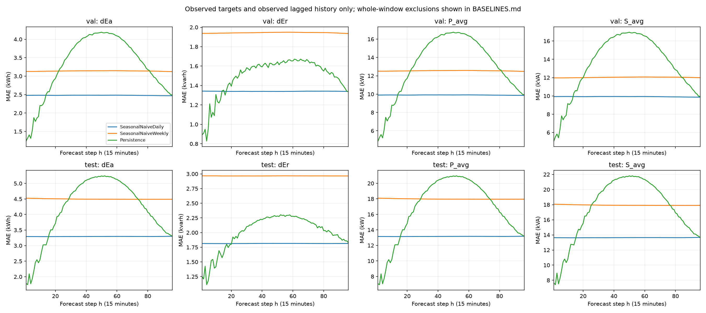

# Seasonal-naive baselines and reusable evaluation

Run `20261115T100324Z_99daa666`. No packages added; no ML/DL, training, ingestion, scaler fitting or window generation. Validation selects references; test is held-out descriptive reporting. All metrics below are physical-unit metrics.

## Model and timing contract

Every model implements fit(train_origins,val_origins)->None, predict(origins)->[n,96,4], n_parameters and name. Origins identify the last input timestamp t. Model output is normalized dEa,dEr,P_avg,S_avg; the reusable harness inverse-transforms using the saved train-only scaler before scoring and saving. Fit and predict calls are timed with a monotonic wall clock; inverse-transform/scoring/export are outside predict_seconds.

Daily: yhat(t+h)=y(t+h-96). Weekly: yhat(t+h)=y(t+h-672). Persistence: yhat(t+h)=y(t). All required readings are at or before t. Persistence uses exactly t; an imputed origin is not replaced by an older reading. Missing or imputed lagged rows produce NaN step vectors; the whole window is then excluded, never zero-filled.

## Excluded windows

| model | split | n_origins | n_scored_windows | n_excluded_windows |
|---|---|---|---|---|
| SeasonalNaiveDaily | val | 25124 | 24168 | 956 |
| SeasonalNaiveDaily | test | 25500 | 24934 | 566 |
| SeasonalNaiveWeekly | val | 25124 | 24135 | 989 |
| SeasonalNaiveWeekly | test | 25500 | 24887 | 613 |
| Persistence | val | 25124 | 25114 | 10 |
| Persistence | test | 25500 | 25494 | 6 |

The saved target origins already require observed, non-imputed labels. Counts above are ADDITIONAL model-specific exclusions from unavailable lagged history. All channel, calendar and horizon metrics retain the full-window mask. Models can have different scoring supports; these are not strictly paired comparisons. Overlapping rolling origins repeat timestamps as forecast cases and must not be treated as independent observations.

## Headline channel metrics

MAE/RMSE use the channel's unit; MAPE/WAPE are percentages; R2 is dimensionless. MAPE omits exact-zero denominators and reports its status/count in benchmark.csv. dEr MAPE is always unreliable because signed reactive energy crosses/approaches zero; use WAPE as its primary percentage error. WAPE divides by sum(abs(y)), preventing cancellation. All-zero denominators yield NA with a reason, never infinity.

| model | split | channel | unit | mae | rmse | r2 | mape_pct | mape_status | wape_pct |
|---|---|---|---|---|---|---|---|---|---|
| SeasonalNaiveDaily | val | dEa | kWh | 2.478990 | 4.166081 | 0.705017 | 17.452168 | ok | 18.195160 |
| SeasonalNaiveDaily | val | dEr | kvarh | 1.340224 | 2.265125 | 0.749651 | 130.844578 | unreliable_signed_near_zero;zero_targets_excluded | 29.344393 |
| SeasonalNaiveDaily | val | P_avg | kW | 9.898290 | 16.646873 | 0.705517 | 17.414089 | ok | 18.161904 |
| SeasonalNaiveDaily | val | S_avg | kVA | 9.915241 | 16.959695 | 0.671950 | 15.366847 | ok | 16.868710 |
| SeasonalNaiveDaily | test | dEa | kWh | 3.294305 | 5.368253 | 0.694272 | 16.818510 | ok | 17.380706 |
| SeasonalNaiveDaily | test | dEr | kvarh | 1.813811 | 2.899625 | 0.771510 | 86.337608 | unreliable_signed_near_zero;zero_targets_excluded | 33.394551 |
| SeasonalNaiveDaily | test | P_avg | kW | 13.158864 | 21.459949 | 0.694576 | 16.786598 | ok | 17.355707 |
| SeasonalNaiveDaily | test | S_avg | kVA | 13.637721 | 22.270271 | 0.672216 | 16.077981 | ok | 17.130241 |
| SeasonalNaiveWeekly | val | dEa | kWh | 3.139296 | 4.983524 | 0.597328 | 24.389568 | ok | 22.873431 |
| SeasonalNaiveWeekly | val | dEr | kvarh | 1.943596 | 3.254408 | 0.494954 | 148.696659 | unreliable_signed_near_zero;zero_targets_excluded | 42.362791 |
| SeasonalNaiveWeekly | val | P_avg | kW | 12.543992 | 19.919857 | 0.597752 | 24.362273 | ok | 22.848334 |
| SeasonalNaiveWeekly | val | S_avg | kVA | 12.026738 | 19.829687 | 0.573552 | 20.029013 | ok | 20.318283 |
| SeasonalNaiveWeekly | test | dEa | kWh | 4.497635 | 7.024914 | 0.478161 | 27.538364 | ok | 23.728425 |
| SeasonalNaiveWeekly | test | dEr | kvarh | 2.966168 | 4.550720 | 0.437264 | 128.265637 | unreliable_signed_near_zero;zero_targets_excluded | 54.614954 |
| SeasonalNaiveWeekly | test | P_avg | kW | 17.978266 | 28.087821 | 0.478490 | 27.515525 | ok | 23.711146 |
| SeasonalNaiveWeekly | test | S_avg | kVA | 17.934649 | 28.084515 | 0.480410 | 24.657659 | ok | 22.527523 |
| Persistence | val | dEa | kWh | 3.291517 | 5.640478 | 0.470157 | 22.433290 | ok | 24.070338 |
| Persistence | val | dEr | kvarh | 1.494512 | 2.476514 | 0.701287 | 130.863637 | unreliable_signed_near_zero;zero_targets_excluded | 32.758969 |
| Persistence | val | P_avg | kW | 13.150198 | 22.545062 | 0.470748 | 22.394703 | ok | 24.040207 |
| Persistence | val | S_avg | kVA | 13.363004 | 23.178925 | 0.401232 | 20.524407 | ok | 22.667445 |
| Persistence | test | dEa | kWh | 4.175210 | 6.643515 | 0.537420 | 20.977396 | ok | 21.940149 |
| Persistence | test | dEr | kvarh | 2.001627 | 3.053995 | 0.747016 | 87.832820 | unreliable_signed_near_zero;zero_targets_excluded | 36.796306 |
| Persistence | test | P_avg | kW | 16.687144 | 26.559326 | 0.537830 | 20.954776 | ok | 21.921174 |
| Persistence | test | S_avg | kVA | 17.405292 | 27.765236 | 0.496811 | 20.444015 | ok | 21.780760 |

## Peak-demand error and physical consistency

For EACH window: PDE_P=abs(max(yhat_P)-max(y_P))/max(y_P); PDE_S analogously. Then average the per-window ratios and multiply by 100. Maxima are over all 96 future steps; this is not the average of per-step relative errors. Nonpositive true maxima are excluded from PDE, with counts in benchmark.csv. No demand-register channel is used as a label.

| model | split | pde_p_pct | pde_s_pct | pde_p_zero_windows | pde_s_zero_windows | consistency_p_median_kw | consistency_s_median_kva |
|---|---|---|---|---|---|---|---|
| SeasonalNaiveDaily | val | 18.753155 | 16.537955 | 0 | 0 | 0.240000 | 0.000000 |
| SeasonalNaiveDaily | test | 17.171353 | 16.275224 | 0 | 0 | 0.300000 | 0.000000 |
| SeasonalNaiveWeekly | val | 23.457576 | 20.542747 | 0 | 0 | 0.250000 | 0.000000 |
| SeasonalNaiveWeekly | test | 28.916086 | 26.822365 | 0 | 0 | 0.300000 | 0.000000 |
| Persistence | val | 27.915710 | 26.430224 | 0 | 0 | 0.240000 | 0.000000 |
| Persistence | test | 26.057853 | 25.648831 | 0 | 0 | 0.300000 | 0.000000 |

Physical diagnostics use the predictions themselves: median abs(P-4*dEa), and median abs(S-hypot(P,4*dEr)). The measured channels already have a nonzero P-minus-4*dEa discrepancy (WINDOWS.md: median 0.25 kW), so copying them need not yield exact zero on that diagnostic. Baselines do not alter copied measurements to manufacture consistency. S and signed dEr were derived consistently in ingestion.

## Forecast-step errors



Figure: reports/figures/baseline_error_by_horizon.png, 150 dpi. h=1 is 15 minutes ahead, h=96 is 24 hours. Each curve uses the same model/split windows at every step. Full metrics for h=1..96 are in baseline_breakdowns.csv. An h-only slice's PDE is over that single retained step; the headline PDE above always uses 96.

## Seasonal breakdown

Calendar cohorts use the FIRST target timestamp, retaining the full 24-hour forecast. Seasons: DJF winter, MAM spring, JJA summer, SON autumn. Month/day-type/non-working breakdowns use the same convention and are all in baseline_breakdowns.csv. Non-working labels remain **RECONSTRUCTED, not official**; existing calendar features were read, not regenerated.

| model | split | group | channel | mae | rmse | r2 | mape_pct | mape_status | wape_pct | pde_p_pct | pde_s_pct |
|---|---|---|---|---|---|---|---|---|---|---|---|
| SeasonalNaiveDaily | val | Autumn | dEa | 4.126168 | 5.979087 | 0.578620 | 21.712931 | ok | 20.930579 | 19.061394 | 17.713448 |
| SeasonalNaiveDaily | val | Autumn | dEr | 2.382385 | 3.182819 | 0.585049 | 328.936768 | unreliable_signed_near_zero;zero_targets_excluded | 58.423811 | 19.061394 | 17.713448 |
| SeasonalNaiveDaily | val | Autumn | P_avg | 16.478264 | 23.887740 | 0.579361 | 21.675304 | ok | 20.896607 | 19.061394 | 17.713448 |
| SeasonalNaiveDaily | val | Autumn | S_avg | 16.888262 | 24.735714 | 0.538907 | 20.391528 | ok | 20.692383 | 19.061394 | 17.713448 |
| SeasonalNaiveDaily | val | Spring | dEa | 1.710857 | 3.127260 | 0.556491 | 14.725833 | ok | 16.005833 | 17.293005 | 14.386448 |
| SeasonalNaiveDaily | val | Spring | dEr | 0.846804 | 1.887349 | 0.715801 | 21.874918 | unreliable_signed_near_zero;ok | 14.526602 | 17.293005 | 14.386448 |
| SeasonalNaiveDaily | val | Spring | P_avg | 6.829405 | 12.500883 | 0.556945 | 14.685277 | ok | 15.971755 | 17.293005 | 14.386448 |
| SeasonalNaiveDaily | val | Spring | S_avg | 6.787637 | 12.487341 | 0.485367 | 12.366953 | ok | 13.720018 | 17.293005 | 14.386448 |
| SeasonalNaiveDaily | val | Winter | dEa | 1.558367 | 2.423978 | 0.478956 | 15.957563 | ok | 15.076774 | 20.159665 | 17.803866 |
| SeasonalNaiveDaily | val | Winter | dEr | 0.766659 | 1.192360 | 0.528397 | 40.056249 | unreliable_signed_near_zero;ok | 21.290921 | 20.159665 | 17.803866 |
| SeasonalNaiveDaily | val | Winter | P_avg | 6.221198 | 9.687951 | 0.479482 | 15.921952 | ok | 15.046309 | 20.159665 | 17.803866 |
| SeasonalNaiveDaily | val | Winter | S_avg | 5.869070 | 9.112312 | 0.505439 | 13.346121 | ok | 13.217387 | 20.159665 | 17.803866 |
| SeasonalNaiveDaily | test | Autumn | dEa | 4.082000 | 6.309816 | 0.617532 | 20.000974 | ok | 20.642957 | 21.763532 | 20.214291 |
| SeasonalNaiveDaily | test | Autumn | dEr | 2.335933 | 3.397190 | 0.695103 | 156.856116 | unreliable_signed_near_zero;zero_targets_excluded | 42.751741 | 21.763532 | 20.214291 |
| SeasonalNaiveDaily | test | Autumn | P_avg | 16.315627 | 25.229080 | 0.617712 | 19.980408 | ok | 20.626688 | 21.763532 | 20.214291 |
| SeasonalNaiveDaily | test | Autumn | S_avg | 16.350961 | 25.705198 | 0.593097 | 18.460743 | ok | 19.672931 | 21.763532 | 20.214291 |
| SeasonalNaiveDaily | test | Summer | dEa | 4.299010 | 6.343870 | 0.532073 | 18.398332 | ok | 17.437984 | 16.252703 | 15.998882 |
| SeasonalNaiveDaily | test | Summer | dEr | 2.319211 | 3.377260 | 0.561410 | 62.095541 | unreliable_signed_near_zero;ok | 35.547205 | 16.252703 | 15.998882 |
| SeasonalNaiveDaily | test | Summer | P_avg | 17.175572 | 25.357342 | 0.532551 | 18.373801 | ok | 17.416061 | 16.252703 | 15.998882 |
| SeasonalNaiveDaily | test | Summer | S_avg | 18.418978 | 26.808750 | 0.495470 | 18.375683 | ok | 17.981285 | 16.252703 | 15.998882 |
| SeasonalNaiveDaily | test | Winter | dEa | 1.379630 | 2.202787 | 0.464242 | 11.717907 | ok | 11.483113 | 13.210496 | 12.333901 |
| SeasonalNaiveDaily | test | Winter | dEr | 0.715322 | 1.361258 | 0.863360 | 36.294211 | unreliable_signed_near_zero;ok | 16.890559 | 13.210496 | 12.333901 |
| SeasonalNaiveDaily | test | Winter | P_avg | 5.495972 | 8.798112 | 0.465395 | 11.665954 | ok | 11.435918 | 13.210496 | 12.333901 |
| SeasonalNaiveDaily | test | Winter | S_avg | 5.639116 | 9.058657 | 0.397582 | 11.074201 | ok | 10.930340 | 13.210496 | 12.333901 |
| SeasonalNaiveWeekly | val | Autumn | dEa | 4.799121 | 6.807914 | 0.488860 | 27.330870 | ok | 24.216004 | 23.094788 | 21.472211 |
| SeasonalNaiveWeekly | val | Autumn | dEr | 3.030905 | 4.012453 | 0.374257 | 337.260799 | unreliable_signed_near_zero;zero_targets_excluded | 72.302996 | 23.094788 | 21.472211 |
| SeasonalNaiveWeekly | val | Autumn | P_avg | 19.177391 | 27.205527 | 0.489539 | 27.308120 | ok | 24.191285 | 23.094788 | 21.472211 |
| SeasonalNaiveWeekly | val | Autumn | S_avg | 19.346292 | 28.175746 | 0.439497 | 24.192473 | ok | 23.544499 | 23.094788 | 21.472211 |
| SeasonalNaiveWeekly | val | Spring | dEa | 2.258547 | 4.000924 | 0.280041 | 18.023413 | ok | 21.087568 | 20.985907 | 18.250446 |
| SeasonalNaiveWeekly | val | Spring | dEr | 1.527968 | 3.405665 | 0.083986 | 42.038632 | unreliable_signed_near_zero;ok | 26.203018 | 20.985907 | 18.250446 |
| SeasonalNaiveWeekly | val | Spring | P_avg | 9.024777 | 16.001282 | 0.280059 | 17.991754 | ok | 21.063924 | 20.985907 | 18.250446 |
| SeasonalNaiveWeekly | val | Spring | S_avg | 8.460851 | 15.000678 | 0.263066 | 14.554078 | ok | 17.072606 | 20.985907 | 18.250446 |
| SeasonalNaiveWeekly | val | Winter | dEa | 2.306785 | 3.312061 | 0.076865 | 28.628434 | ok | 22.163469 | 26.807507 | 22.215871 |
| SeasonalNaiveWeekly | val | Winter | dEr | 1.206405 | 1.776121 | -0.059552 | 61.994157 | unreliable_signed_near_zero;ok | 33.905822 | 26.807507 | 22.215871 |
| SeasonalNaiveWeekly | val | Winter | P_avg | 9.216132 | 13.241354 | 0.077317 | 28.601182 | ok | 22.135914 | 26.807507 | 22.215871 |
| SeasonalNaiveWeekly | val | Winter | S_avg | 7.977284 | 11.809373 | 0.203692 | 21.823993 | ok | 17.876494 | 26.807507 | 22.215871 |
| SeasonalNaiveWeekly | test | Autumn | dEa | 5.149796 | 6.898739 | 0.551851 | 29.934593 | ok | 25.953007 | 29.714400 | 26.863191 |
| SeasonalNaiveWeekly | test | Autumn | dEr | 3.728058 | 5.068375 | 0.329278 | 224.599694 | unreliable_signed_near_zero;zero_targets_excluded | 67.901426 | 29.714400 | 26.863191 |
| SeasonalNaiveWeekly | test | Autumn | P_avg | 20.587600 | 27.576111 | 0.552321 | 29.918926 | ok | 25.937642 | 29.714400 | 26.863191 |
| SeasonalNaiveWeekly | test | Autumn | S_avg | 19.379897 | 26.661378 | 0.571635 | 25.109772 | ok | 23.236330 | 29.714400 | 26.863191 |
| SeasonalNaiveWeekly | test | Summer | dEa | 6.625145 | 9.633456 | -0.091063 | 38.677951 | ok | 26.952912 | 42.013705 | 39.608039 |
| SeasonalNaiveWeekly | test | Summer | dEr | 3.857056 | 5.595388 | -0.217812 | 90.167225 | unreliable_signed_near_zero;ok | 59.524988 | 42.013705 | 39.608039 |
| SeasonalNaiveWeekly | test | Summer | P_avg | 26.489614 | 38.524838 | -0.090988 | 38.654345 | ok | 26.939902 | 42.013705 | 39.608039 |
| SeasonalNaiveWeekly | test | Summer | S_avg | 27.459265 | 39.098169 | -0.086613 | 35.662639 | ok | 26.892274 | 42.013705 | 39.608039 |
| SeasonalNaiveWeekly | test | Winter | dEa | 1.520133 | 2.197860 | 0.458622 | 13.049056 | ok | 12.683447 | 14.062324 | 13.120556 |
| SeasonalNaiveWeekly | test | Winter | dEr | 1.191028 | 2.001214 | 0.697051 | 64.851441 | unreliable_signed_near_zero;ok | 28.045810 | 14.062324 | 13.120556 |
| SeasonalNaiveWeekly | test | Winter | P_avg | 6.066113 | 8.778302 | 0.459775 | 13.019286 | ok | 12.653058 | 14.062324 | 13.120556 |
| SeasonalNaiveWeekly | test | Winter | S_avg | 6.198331 | 9.086203 | 0.395682 | 12.413450 | ok | 12.039368 | 14.062324 | 13.120556 |
| Persistence | val | Autumn | dEa | 5.806886 | 8.715098 | 0.144917 | 29.411488 | ok | 29.370380 | 34.462804 | 33.955893 |
| Persistence | val | Autumn | dEr | 2.695405 | 3.668699 | 0.466543 | 324.226597 | unreliable_signed_near_zero;zero_targets_excluded | 64.979135 | 34.462804 | 33.955893 |
| Persistence | val | Autumn | P_avg | 23.205579 | 34.836248 | 0.145596 | 29.378394 | ok | 29.341883 | 34.462804 | 33.955893 |
| Persistence | val | Autumn | S_avg | 23.855890 | 36.087251 | 0.062267 | 28.280065 | ok | 29.116687 | 34.462804 | 33.955893 |
| Persistence | val | Spring | dEa | 1.937514 | 3.258561 | 0.518466 | 17.123681 | ok | 18.126316 | 24.453637 | 22.203261 |
| Persistence | val | Spring | dEr | 0.886652 | 1.764201 | 0.751679 | 22.992666 | unreliable_signed_near_zero;ok | 15.210194 | 24.453637 | 22.203261 |
| Persistence | val | Spring | P_avg | 7.739888 | 13.025965 | 0.518944 | 17.090672 | ok | 18.101078 | 24.453637 | 22.203261 |
| Persistence | val | Spring | S_avg | 7.816299 | 13.148826 | 0.429400 | 14.688123 | ok | 15.799277 | 24.453637 | 22.203261 |
| Persistence | val | Winter | dEa | 2.111407 | 2.879212 | 0.303290 | 20.867326 | ok | 20.130437 | 24.775714 | 23.092956 |
| Persistence | val | Winter | dEr | 0.888691 | 1.296592 | 0.432938 | 44.331913 | unreliable_signed_near_zero;ok | 24.630244 | 24.775714 | 23.092956 |
| Persistence | val | Winter | P_avg | 8.429956 | 11.500354 | 0.304891 | 20.816778 | ok | 20.092034 | 24.775714 | 23.092956 |
| Persistence | val | Winter | S_avg | 8.328527 | 11.233141 | 0.280125 | 18.712636 | ok | 18.510397 | 24.775714 | 23.092956 |
| Persistence | test | Autumn | dEa | 5.427899 | 8.482177 | 0.333305 | 25.465535 | ok | 27.180204 | 30.146645 | 29.347813 |
| Persistence | test | Autumn | dEr | 2.554832 | 3.661156 | 0.651925 | 156.222547 | unreliable_signed_near_zero;zero_targets_excluded | 46.457078 | 30.146645 | 29.347813 |
| Persistence | test | Autumn | P_avg | 21.702128 | 33.915286 | 0.333615 | 25.450368 | ok | 27.167545 | 30.146645 | 29.347813 |
| Persistence | test | Autumn | S_avg | 22.195766 | 35.025808 | 0.273027 | 24.384984 | ok | 26.455782 | 30.146645 | 29.347813 |
| Persistence | test | Summer | dEa | 4.921878 | 7.121880 | 0.403291 | 19.743207 | ok | 19.890068 | 26.486781 | 26.963515 |
| Persistence | test | Summer | dEr | 2.419048 | 3.443029 | 0.536649 | 59.774750 | unreliable_signed_near_zero;ok | 37.074861 | 26.486781 | 26.963515 |
| Persistence | test | Summer | P_avg | 19.669705 | 28.467040 | 0.403898 | 19.722444 | ok | 19.870758 | 26.486781 | 26.963515 |
| Persistence | test | Summer | S_avg | 20.994784 | 30.283199 | 0.348572 | 19.962862 | ok | 20.425653 | 26.486781 | 26.963515 |
| Persistence | test | Winter | dEa | 2.074711 | 2.828091 | 0.121005 | 17.557944 | ok | 17.233187 | 21.311134 | 20.381333 |
| Persistence | test | Winter | dEr | 0.981919 | 1.545329 | 0.825782 | 45.453471 | unreliable_signed_near_zero;ok | 23.172237 | 21.311134 | 20.381333 |
| Persistence | test | Winter | P_avg | 8.285024 | 11.301488 | 0.121953 | 17.525541 | ok | 17.204071 | 21.311134 | 20.381333 |
| Persistence | test | Winter | S_avg | 8.601572 | 11.762658 | -0.011908 | 16.808529 | ok | 16.638813 | 21.311134 | 20.381333 |

## Frugality

| model | split | n_parameters | fit_seconds | predict_seconds | peak_rss_mb |
|---|---|---|---|---|---|
| SeasonalNaiveDaily | val | 0 | 0.000002 | 0.225047 | 656.158720 |
| SeasonalNaiveDaily | test | 0 | 0.000001 | 0.085512 | 670.302208 |
| SeasonalNaiveWeekly | val | 0 | 0.000001 | 0.088044 | 656.707584 |
| SeasonalNaiveWeekly | test | 0 | 0.000002 | 0.086225 | 671.793152 |
| Persistence | val | 0 | 0.000001 | 0.090949 | 664.485888 |
| Persistence | test | 0 | 0.000002 | 0.081719 | 674.652160 |

Each model/split ran once in a fresh worker, sequentially, with numerical threads limited to 1. Peak RSS is the worker lifetime high-water mark in decimal MB, including loading, forecast/target arrays, scoring and serialization. It is not parameter memory alone. No [n,672,11] input array is materialized. The no-op fit timings are measured, not replaced by an assumed zero.

## Which reference is hardest to beat?

Using validation PDE_S as the peak-demand reference, **SeasonalNaiveDaily** is hardest to beat here with PDE_S **16.5380%** and S_avg WAPE **16.8687%**. It reuses yesterday's full quarter-hour profile, preserving daily shape instead of a flat line while tracking recent conditions. This is a validation-only choice, not a claim that the same model wins every channel or season. Different exclusions also limit direct comparisons. Channel-specific validation winners are:

| channel | lowest_validation_WAPE_model | WAPE_pct |
|---|---|---|
| dEa | SeasonalNaiveDaily | 18.195160 |
| dEr | SeasonalNaiveDaily | 29.344393 |
| P_avg | SeasonalNaiveDaily | 18.161904 |
| S_avg | SeasonalNaiveDaily | 16.868710 |

A later model should be compared against all three. Persistence is the additional floor; the two seasonal-naive references are required by the specification. Test results were not used to select the reference.

## Output schema and provenance

[BENCHMARK_SCHEMA.md](BENCHMARK_SCHEMA.md) defines all fixed CSV columns, formulas, undefined-value policies, cohort semantics and the prediction Parquet schema. Reports append one row per (run,model,split,channel) to benchmark.csv. Immutable prediction versions preserve old run provenance; latest aliases are at data/predictions/<model>_<split>.parquet. Predictions include all candidate origins and their is_scored flags.

Source/scaler/origin hashes and source-file hashes are recorded in baseline_run.json. Source Parquets and processed features were checked unchanged after this invocation. Total benchmark invocation runtime: 26.043 seconds.

## Pytest output

```text
============================= test session starts ==============================
platform linux -- Python 3.12.3, pytest-9.2.0, pluggy-1.7.0
rootdir: /home/khalifa/supcom-energy-forcast
plugins: platformdirs-4.14.5, anyio-4.16.0
collected 92 items

tests/test_behaviour.py ........................                         [ 26%]
tests/test_contracts.py ....                                             [ 30%]
tests/test_ingestion.py .............................                    [ 61%]
tests/test_metrics.py ...............                                    [ 78%]
tests/test_windows.py ...................s                               [100%]

=========================== short test summary info ============================
SKIPPED [1] tests/test_windows.py:230: Torch not installed; only holidays/scikit-learn additions authorized
======================== 91 passed, 1 skipped in 8.82s =========================
```
