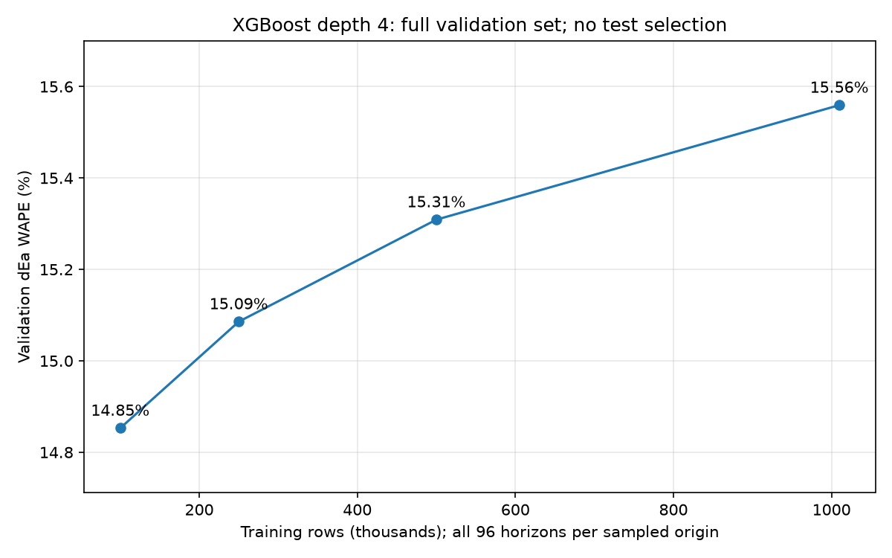
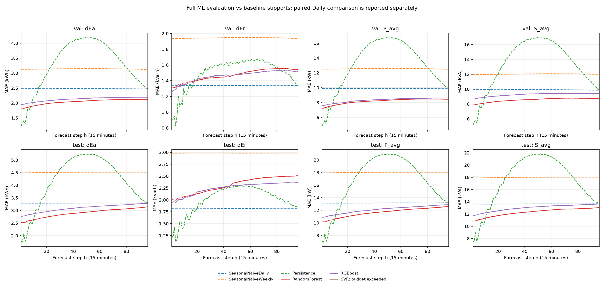
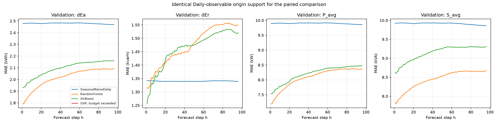

# Classical multi-horizon forecasting — CPU only

Branch feat/forecast-ml, extending benchmark cohort `20261115T100324Z_99daa666` without changing its 35-column schema. Only xgboost was added directly. No deep learning or GPU work. Existing ingestion, calendar and split artifacts were reused unchanged.

## Exact features: 64, not approximately 50

32 lag values (8 lags × 4 electrical channels), 24 trailing summaries (3 widths ×2 statistics × 4 channels), 7 target-calendar features, and h. Order and dependency bounds:

| position | name | source | earliest_relative_electrical_row | latest_relative_electrical_row |
|---|---|---|---|---|
| 1 | dEa_lag_0 | electrical_history | 0.000000 | 0.000000 |
| 2 | dEa_lag_1 | electrical_history | -1.000000 | -1.000000 |
| 3 | dEa_lag_2 | electrical_history | -2.000000 | -2.000000 |
| 4 | dEa_lag_3 | electrical_history | -3.000000 | -3.000000 |
| 5 | dEa_lag_4 | electrical_history | -4.000000 | -4.000000 |
| 6 | dEa_lag_96 | electrical_history | -96.000000 | -96.000000 |
| 7 | dEa_lag_192 | electrical_history | -192.000000 | -192.000000 |
| 8 | dEa_lag_672 | electrical_history | -672.000000 | -672.000000 |
| 9 | dEr_lag_0 | electrical_history | 0.000000 | 0.000000 |
| 10 | dEr_lag_1 | electrical_history | -1.000000 | -1.000000 |
| 11 | dEr_lag_2 | electrical_history | -2.000000 | -2.000000 |
| 12 | dEr_lag_3 | electrical_history | -3.000000 | -3.000000 |
| 13 | dEr_lag_4 | electrical_history | -4.000000 | -4.000000 |
| 14 | dEr_lag_96 | electrical_history | -96.000000 | -96.000000 |
| 15 | dEr_lag_192 | electrical_history | -192.000000 | -192.000000 |
| 16 | dEr_lag_672 | electrical_history | -672.000000 | -672.000000 |
| 17 | P_avg_lag_0 | electrical_history | 0.000000 | 0.000000 |
| 18 | P_avg_lag_1 | electrical_history | -1.000000 | -1.000000 |
| 19 | P_avg_lag_2 | electrical_history | -2.000000 | -2.000000 |
| 20 | P_avg_lag_3 | electrical_history | -3.000000 | -3.000000 |
| 21 | P_avg_lag_4 | electrical_history | -4.000000 | -4.000000 |
| 22 | P_avg_lag_96 | electrical_history | -96.000000 | -96.000000 |
| 23 | P_avg_lag_192 | electrical_history | -192.000000 | -192.000000 |
| 24 | P_avg_lag_672 | electrical_history | -672.000000 | -672.000000 |
| 25 | S_avg_lag_0 | electrical_history | 0.000000 | 0.000000 |
| 26 | S_avg_lag_1 | electrical_history | -1.000000 | -1.000000 |
| 27 | S_avg_lag_2 | electrical_history | -2.000000 | -2.000000 |
| 28 | S_avg_lag_3 | electrical_history | -3.000000 | -3.000000 |
| 29 | S_avg_lag_4 | electrical_history | -4.000000 | -4.000000 |
| 30 | S_avg_lag_96 | electrical_history | -96.000000 | -96.000000 |
| 31 | S_avg_lag_192 | electrical_history | -192.000000 | -192.000000 |
| 32 | S_avg_lag_672 | electrical_history | -672.000000 | -672.000000 |
| 33 | dEa_rolling_mean_4 | electrical_history | -3.000000 | 0.000000 |
| 34 | dEa_rolling_std_4 | electrical_history | -3.000000 | 0.000000 |
| 35 | dEa_rolling_mean_96 | electrical_history | -95.000000 | 0.000000 |
| 36 | dEa_rolling_std_96 | electrical_history | -95.000000 | 0.000000 |
| 37 | dEa_rolling_mean_672 | electrical_history | -671.000000 | 0.000000 |
| 38 | dEa_rolling_std_672 | electrical_history | -671.000000 | 0.000000 |
| 39 | dEr_rolling_mean_4 | electrical_history | -3.000000 | 0.000000 |
| 40 | dEr_rolling_std_4 | electrical_history | -3.000000 | 0.000000 |
| 41 | dEr_rolling_mean_96 | electrical_history | -95.000000 | 0.000000 |
| 42 | dEr_rolling_std_96 | electrical_history | -95.000000 | 0.000000 |
| 43 | dEr_rolling_mean_672 | electrical_history | -671.000000 | 0.000000 |
| 44 | dEr_rolling_std_672 | electrical_history | -671.000000 | 0.000000 |
| 45 | P_avg_rolling_mean_4 | electrical_history | -3.000000 | 0.000000 |
| 46 | P_avg_rolling_std_4 | electrical_history | -3.000000 | 0.000000 |
| 47 | P_avg_rolling_mean_96 | electrical_history | -95.000000 | 0.000000 |
| 48 | P_avg_rolling_std_96 | electrical_history | -95.000000 | 0.000000 |
| 49 | P_avg_rolling_mean_672 | electrical_history | -671.000000 | 0.000000 |
| 50 | P_avg_rolling_std_672 | electrical_history | -671.000000 | 0.000000 |
| 51 | S_avg_rolling_mean_4 | electrical_history | -3.000000 | 0.000000 |
| 52 | S_avg_rolling_std_4 | electrical_history | -3.000000 | 0.000000 |
| 53 | S_avg_rolling_mean_96 | electrical_history | -95.000000 | 0.000000 |
| 54 | S_avg_rolling_std_96 | electrical_history | -95.000000 | 0.000000 |
| 55 | S_avg_rolling_mean_672 | electrical_history | -671.000000 | 0.000000 |
| 56 | S_avg_rolling_std_672 | electrical_history | -671.000000 | 0.000000 |
| 57 | target_hour_sin | known_future_calendar | NA | NA |
| 58 | target_hour_cos | known_future_calendar | NA | NA |
| 59 | target_weekday_sin | known_future_calendar | NA | NA |
| 60 | target_weekday_cos | known_future_calendar | NA | NA |
| 61 | target_doy_sin | known_future_calendar | NA | NA |
| 62 | target_doy_cos | known_future_calendar | NA | NA |
| 63 | target_is_non_working_day | known_future_calendar | NA | NA |
| 64 | h | known_horizon | NA | NA |

Lags 0..4 capture the latest hour,96/192 capture one/two days,672 captures the preceding week. Trailing 4/96/672 intervals cover the last hour/day/week, ending at t inclusively; std uses ddof=0. Electrical inputs and targets use the existing train-only normalization. Calendar values are unscaled. h is 1..96; SVR alone divides h by its known bound 96 before kernel computation. This uses no fitted or future information.

The 7 calendar features are evaluated at TARGET t+h. Clock, weekday, day-of-year and the reconstructed holiday/vacation calendar are known in advance, so this is legitimate and is not leakage. The academic calendar remains **RECONSTRUCTED, not official**. No future electrical measurement enters a feature. Historical imputed INPUTS are allowed; imputed TARGETS are explicitly rejected before label reads.

The literal t-672 lag needs 673 timestamps rather than the original 672-slot input. This excludes 1 of 73640 training origins before stride sampling. Published validation/test scoring still considers every saved origin; incomplete predictions would be counted as exclusions.

## Sampling and its measured justification

Usable training origins: 73639; every seventh yields **10520 origins × 96 = 1,009,920 rows**. The float32 training feature payload is 258,539,520 bytes. This is a training-cost concession. Consecutive canonical input windows share 671/672 readings, so training on every origin repeats much of the same history. Sampling reduces that overlap; it is not a proof of lossless information retention. Fixed stride 7 avoids a fixed quarter-hour phase. Observed selected-origin minute counts: {'0': 2630, '15': 2631, '30': 2630, '45': 2629}. All 26 training months are represented; counts are in forecast_ml_population.json.

### Learning curve before the main runs

Nested deterministic time-spread subsets keep ALL 96 horizons per chosen origin. Requested 100k/250k/500k sizes are rounded to whole origins; actual counts below. Four XGB depth 4,200-tree fits use all 25,124 validation origins and all 2,411,904 target pairs. No test scoring influenced these experiments.

| requested_rows | actual_rows | training_origins | validation_origins | validation_pairs | val_dEa_wape_pct | fit_seconds | predict_seconds |
|---|---|---|---|---|---|---|---|
| 100000 | 100032 | 1042 | 25124 | 2411904 | 14.852774 | 1.882069 | 2.293121 |
| 250000 | 249984 | 2604 | 25124 | 2411904 | 15.085705 | 4.290207 | 2.332722 |
| 500000 | 499968 | 5208 | 25124 | 2411904 | 15.308823 | 7.645081 | 2.297511 |
| 1009920 | 1009920 | 10520 | 25124 | 2411904 | 15.559403 | 15.671372 | 2.299904 |

Actual quarter-hour coverage in every nested curve subset is shown below. All four phases are present, with modest count differences; this is one deterministic learning curve, not a repeated-seed uncertainty estimate.

| training_rows | minute_00 | minute_15 | minute_30 | minute_45 |
|---|---|---|---|---|
| 100032 | 259 | 261 | 250 | 272 |
| 249984 | 649 | 655 | 620 | 680 |
| 499968 | 1266 | 1332 | 1271 | 1339 |
| 1009920 | 2630 | 2631 | 2630 | 2629 |



Full-minus500k validation WAPE change: +0.250580 percentage points. The curve worsens as rows increase; it does not support a claim that this fixed configuration is data-limited or that more rows would improve it. More data did not fix its error. The full stride 7 sample was retained for XGBoost and RF's initial attempt as requested; any budget-triggered RF reduction is detailed below. This one-channel XGB curve cannot establish RF/SVR sufficiency.

Completed RF dEa candidates also provide same-depth full/half comparisons without any extra fits. These are descriptive checks from the budgeted attempts, not a four-channel or repeated-seed learning curve:

| training_rows | max_depth | val_dEa_wape_pct | candidate_fit_seconds |
|---|---|---|---|
| 1009920 | 12 | 15.943358 | 868.746598 |
| 1009920 | 8 | 15.145995 | 628.952098 |
| 504960 | 12 | 15.342210 | 383.598457 |
| 504960 | 8 | 14.903329 | 279.584303 |

## Strategy and small search

**Pooled direct multi-horizon with h as a predictor:** four scalar regressors per family, one per channel, shared across all 96 steps. During predict, each regressor is called96 times on batched origins. No predicted electrical value is fed back recursively. The alternative is one model per channel/horizon,384 models; sharing across h lowers storage/search cost and lets neighbouring horizons share training information, at the cost of less horizon-specific flexibility.

Full-sample candidates are selected separately per channel by minimum physical-unit validation WAPE. The RF half-size retry, if needed, selects depth on dEa and shares it across heads as described below. EVERY candidate uses all eligible validation origin/horizon pairs; validation is never subsampled. Training labels stay in train. Validation only selects hyperparameters and never enters estimator.fit. Selected candidates are retained without a train+val refit. All three families finish selection or hit their explicit budget before any test scoring begins.

```json
{
  "training_origin_stride": 7,
  "random_seed": 2026,
  "rf_fit_budget_seconds": 2700,
  "svr_budget_seconds": 1800,
  "svr_training_rows": 20000,
  "rf": {
    "n_estimators": 200,
    "max_depth_grid": [
      12,
      8
    ],
    "max_features": 0.5,
    "min_samples_leaf": 4,
    "n_jobs": 2
  },
  "xgb": {
    "n_estimators": 200,
    "max_depth_grid": [
      4,
      8
    ],
    "learning_rate": 0.05,
    "subsample": 0.8,
    "colsample_bytree": 0.8,
    "tree_method": "hist",
    "device": "cpu",
    "n_jobs": 2
  },
  "svr": {
    "kernel": "rbf",
    "C_grid": [
      1.0,
      10.0
    ],
    "epsilon": 0.1,
    "gamma": "scale",
    "cache_size": 512
  },
  "learning_curve": {
    "requested_rows": [
      100000,
      250000,
      500000
    ],
    "max_depth": 4,
    "flat_wape_threshold_percentage_points": 0.5
  }
}
```

[RF documentation](https://scikit-learn.org/stable/modules/generated/sklearn.ensemble.RandomForestRegressor.html), [XGBoost CPU/hist parameters](https://xgboost.readthedocs.io/en/stable/parameter.html), [RBF SVR and its scaling cost](https://scikit-learn.org/stable/modules/generated/sklearn.svm.SVR.html). RF/XGB use at most 2 jobs/threads; BLAS uses 1. XGB explicitly uses device=cpu and hist; CUDA_VISIBLE_DEVICES=-1.

| model | channel | selected_parameters | validation_wape_pct |
|---|---|---|---|
| RandomForest | dEa | {"max_depth": 8} | 14.903329 |
| RandomForest | dEr | {"max_depth": 8} | 32.223886 |
| RandomForest | P_avg | {"max_depth": 8} | 14.947227 |
| RandomForest | S_avg | {"max_depth": 8} | 14.493173 |
| XGBoost | dEa | {"max_depth": 4} | 15.559403 |
| XGBoost | dEr | {"max_depth": 4} | 32.005822 |
| XGBoost | P_avg | {"max_depth": 4} | 15.226473 |
| XGBoost | S_avg | {"max_depth": 4} | 15.693357 |

## Training rows, budgets and computational cost

| model | status | training_rows | sampled_origins | base_origin_stride | half_sample | fit_seconds_all_attempts | n_parameters | sample_sufficiency |
|---|---|---|---|---|---|---|---|---|
| RandomForest | completed | 504960 | 5260 | 7 | True | 4231.627711 | 605624 | RF dEa full/half comparisons; no four-channel sufficiency proof |
| XGBoost | completed | 1009920 | 10520 | 7 | False | 207.970246 | 36753 | no benefit from more rows for fixed depth 4 |
| SVR | did not converge within budget | 20000 | 209 | 7 | False | 1800.250802 | 0 | not established; computational cap only |

| model | attempt | elapsed_seconds | budget_seconds | timed_out | peak_rss_mb |
|---|---|---|---|---|---|
| XGBoost | full | 210.035870 | NA | False | 1840.185344 |
| RandomForest | full | 2700.394543 | 2700.000000 | True | 1841.930240 |
| RandomForest | half | 1534.219429 | 2700.000000 | False | 1690.980352 |
| SVR | full | 1800.250802 | 1800.000000 | True | 2287.546368 |

RF has a 45-minute budget for its complete fit/selection call. On timeout the runner kills only its own child PID and retries at half the selected origins. A deterministic keep-four-of-eight pattern preserves quarter-hour phases; simply changing stride 7 to 14 would not. The retry also selects one shared depth on dEa and reuses it for the other three heads: five candidate forests instead of eight, with 200 trees in every final head. This is an explicit budget concession, not a claim that the dEa-selected depth is optimal for every channel. SVR uses exactly 20,000 deterministic training pairs and a 30-minute fit/selection budget. For the SVR cap, 209 time-spread origins are chosen from the stride 7 pool; their 20,064 pairs are evenly thinned to 20,000. This extra training concession is deterministic and retains all 96 horizon values; it never thins evaluation.

The SVR cap does not affect validation/test population sizes. Budget times include validation selection; individual candidate fit and validation seconds are retained in the model fit JSON.

SVR: **did not converge within budget** for the complete fit/validation-selection procedure. Last recorded phase: candidate_validation, channel dEa, parameters {'C': 10.0}.  The last individual fit call had already returned in 12.478077 seconds before full validation prediction began. An individual channel fit may have converged before validation/selection hit the time limit; this is not a claim about LIBSVM's internal convergence status. No completed four-channel model was available. Benchmark rows are retained with NA metrics, zero scored windows and NaN predictions; it was not silently dropped.

Completed individual SVR candidate diagnostics are retained below. A completed single-channel candidate does not constitute a selected four-channel family and is not substituted for the joint benchmark:

| channel | C | validation_wape_pct | candidate_fit_seconds | validation_seconds | candidate_parameters |
|---|---|---|---|---|---|
| dEa | 1.000000 | 18.854158 | 10.256457 | 1381.412502 | 664041 |

## Full-population physical-unit metrics

Every saved validation/test origin is evaluated: 25,124/25,500, respectively. Successful ML models use identical origin supports; budget failures remain explicit unscored rows, not fabricated forecasts. MAPE is flagged unreliable for signed dEr; WAPE is primary. All formulas and zero-denominator policies are unchanged.

| model | split | channel | mae | rmse | r2 | mape_pct | mape_status | wape_pct |
|---|---|---|---|---|---|---|---|---|
| XGBoost | val | dEa | 2.127726 | 3.283501 | 0.820436 | 15.083737 | ok | 15.559403 |
| XGBoost | val | dEr | 1.460144 | 2.102331 | 0.784726 | 96.356481 | unreliable_signed_near_zero;zero_targets_excluded | 32.005822 |
| XGBoost | val | P_avg | 8.329179 | 12.881186 | 0.827217 | 14.754668 | ok | 15.226473 |
| XGBoost | val | S_avg | 9.251745 | 13.689712 | 0.791125 | 15.222715 | ok | 15.693357 |
| XGBoost | test | dEa | 3.091477 | 4.520212 | 0.785880 | 16.026141 | ok | 16.244715 |
| XGBoost | test | dEr | 2.248106 | 2.972252 | 0.760380 | 82.645458 | unreliable_signed_near_zero;zero_targets_excluded | 41.326854 |
| XGBoost | test | P_avg | 12.128588 | 17.868602 | 0.790831 | 15.672719 | ok | 15.932240 |
| XGBoost | test | S_avg | 13.005468 | 18.662216 | 0.772698 | 16.036419 | ok | 16.274346 |
| RandomForest | val | dEa | 2.038009 | 3.229022 | 0.826346 | 14.541411 | ok | 14.903329 |
| RandomForest | val | dEr | 1.470092 | 2.096614 | 0.785895 | 106.240993 | unreliable_signed_near_zero;zero_targets_excluded | 32.223886 |
| RandomForest | val | P_avg | 8.176426 | 12.926561 | 0.825998 | 14.583909 | ok | 14.947227 |
| RandomForest | val | S_avg | 8.544198 | 13.228246 | 0.804970 | 13.481039 | ok | 14.493173 |
| RandomForest | test | dEa | 2.895748 | 4.392981 | 0.797764 | 14.697855 | ok | 15.216222 |
| RandomForest | test | dEr | 2.308458 | 2.978041 | 0.759446 | 83.502127 | unreliable_signed_near_zero;zero_targets_excluded | 42.436296 |
| RandomForest | test | P_avg | 11.657523 | 17.679891 | 0.795225 | 14.770368 | ok | 15.313443 |
| RandomForest | test | S_avg | 12.292144 | 18.073896 | 0.786803 | 14.981412 | ok | 15.381730 |
| SVR | val | dEa | NA | NA | NA | NA | undefined_no_scored_windows | NA |
| SVR | val | dEr | NA | NA | NA | NA | undefined_no_scored_windows | NA |
| SVR | val | P_avg | NA | NA | NA | NA | undefined_no_scored_windows | NA |
| SVR | val | S_avg | NA | NA | NA | NA | undefined_no_scored_windows | NA |
| SVR | test | dEa | NA | NA | NA | NA | undefined_no_scored_windows | NA |
| SVR | test | dEr | NA | NA | NA | NA | undefined_no_scored_windows | NA |
| SVR | test | P_avg | NA | NA | NA | NA | undefined_no_scored_windows | NA |
| SVR | test | S_avg | NA | NA | NA | NA | undefined_no_scored_windows | NA |

| model | split | n_origins | n_scored_windows | n_excluded_windows | pde_p_pct | pde_s_pct |
|---|---|---|---|---|---|---|
| XGBoost | val | 25124 | 25124 | 0 | 17.218214 | 18.047587 |
| XGBoost | test | 25500 | 25500 | 0 | 17.801119 | 18.318674 |
| RandomForest | val | 25124 | 25124 | 0 | 18.100881 | 18.804291 |
| RandomForest | test | 25500 | 25500 | 0 | 19.338214 | 19.671564 |
| SVR | val | 25124 | 0 | 25124 | NA | NA |
| SVR | test | 25500 | 0 | 25500 | NA | NA |

PDE_S/PDE_P remain the mean per-window relative error of the maximum across96 physical-unit target steps. They are not per-step percentage errors. The four channels are predicted independently; consistency is measured rather than forced.

## Beaten or not beaten: paired validation comparison with SeasonalNaiveDaily

The Daily baseline intentionally cannot forecast windows needing imputed historical readings. ML may use imputed inputs, so its full-population support is larger. To avoid an unequal-support claim, compare each ML model with Daily on the SAME Daily-observable origin intersection below. No evaluation origins were randomly subsampled. The complete-population benchmark rows remain separate and show their counts. This paired table is the basis for the beaten/not-beaten statements.

| model | split | channel | n_origins | n_scored_windows | n_excluded_windows | ml_wape_pct | daily_wape_pct | wape_result | ml_pde_s_pct | daily_pde_s_pct | pde_s_result |
|---|---|---|---|---|---|---|---|---|---|---|---|
| XGBoost | val | dEa | 25124 | 24168 | 956 | 15.380603 | 18.195160 | beaten | 17.933754 | 16.537955 | not beaten |
| XGBoost | val | dEr | 25124 | 24168 | 956 | 32.003684 | 29.344393 | not beaten | 17.933754 | 16.537955 | not beaten |
| XGBoost | val | P_avg | 25124 | 24168 | 956 | 15.053190 | 18.161904 | beaten | 17.933754 | 16.537955 | not beaten |
| XGBoost | val | S_avg | 25124 | 24168 | 956 | 15.558817 | 16.868710 | beaten | 17.933754 | 16.537955 | not beaten |
| RandomForest | val | dEa | 25124 | 24168 | 956 | 14.795410 | 18.195160 | beaten | 18.656368 | 16.537955 | not beaten |
| RandomForest | val | dEr | 25124 | 24168 | 956 | 32.243707 | 29.344393 | not beaten | 18.656368 | 16.537955 | not beaten |
| RandomForest | val | P_avg | 25124 | 24168 | 956 | 14.831841 | 18.161904 | beaten | 18.656368 | 16.537955 | not beaten |
| RandomForest | val | S_avg | 25124 | 24168 | 956 | 14.364347 | 16.868710 | beaten | 18.656368 | 16.537955 | not beaten |
| SVR | val | dEa | 25124 | 0 | 25124 | NA | NA | not evaluated: budget | NA | NA | not evaluated: budget |
| SVR | val | dEr | 25124 | 0 | 25124 | NA | NA | not evaluated: budget | NA | NA | not evaluated: budget |
| SVR | val | P_avg | 25124 | 0 | 25124 | NA | NA | not evaluated: budget | NA | NA | not evaluated: budget |
| SVR | val | S_avg | 25124 | 0 | 25124 | NA | NA | not evaluated: budget | NA | NA | not evaluated: budget |

- RandomForest: validation WAPE **beaten** for dEa, P_avg, S_avg; **not beaten** for dEr. Validation PDE_S: **not beaten**.
- XGBoost: validation WAPE **beaten** for dEa, P_avg, S_avg; **not beaten** for dEr. Validation PDE_S: **not beaten**.
- SVR: **not evaluated within budget**; no claim of beating Daily is supported.

Paired test comparisons are descriptive only and are in forecast_ml_paired_daily.csv. Test was scored once for each selected family after all validation-only selection completed. A budget-failed model has no test score.

## Error by horizon



All three baseline curves are overlaid. The full ML curves use every eligible origin; baseline curves retain their existing missing-lag exclusions, so their raw supports differ. The paired validation figure below uses the same Daily-observable rows:



Short-horizon validation P errors on the same Daily-observable support (15 minutes, 1 hour, 24 hours):

| model | P_MAE_h1_kW | P_MAE_h4_kW | P_MAE_h96_kW |
|---|---|---|---|
| SeasonalNaiveDaily | 9.895388 | 9.900580 | 9.856006 |
| RandomForest | 7.197745 | 7.297357 | 8.376162 |
| XGBoost | 7.538647 | 7.585397 | 8.485220 |
| SVR | NA | NA | NA |

All figures are PNG at 150 dpi. Forecast-step metrics, as well as month, season, weekday/weekend and non-working cohorts, are in forecast_ml_breakdowns.csv. Existing first-target-timestamp cohort definitions are unchanged.

## Frugality and physical consistency

| model | split | n_parameters | fit_seconds | predict_seconds | peak_rss_mb | consistency_p_median_kw | consistency_s_median_kva |
|---|---|---|---|---|---|---|---|
| XGBoost | val | 36753 | 207.970246 | 9.751321 | 1840.185344 | 0.625075 | 1.674381 |
| XGBoost | test | 36753 | 207.970246 | 9.895415 | 1840.185344 | 1.064052 | 1.554918 |
| RandomForest | val | 605624 | 4231.627711 | 51.528174 | 1841.930240 | 0.224033 | 1.531239 |
| RandomForest | test | 605624 | 4231.627711 | 51.268942 | 1841.930240 | 0.420919 | 1.975244 |
| SVR | val | 0 | 1800.250802 | NA | 2287.546368 | NA | NA |
| SVR | test | 0 | 1800.250802 | NA | 2287.546368 | NA | NA |

fit_seconds includes the complete validation-selection fit call; a timed-out RF attempt is additionally charged if a reduced retry succeeds. The fit is reused for validation and test, not performed twice. predict_seconds times only the model.predict call for that split. Peak RSS is the maximum observed across its fitting attempts and evaluation worker, in decimal MB, including feature matrices and scoring/export.

Preliminary XGB learning-curve work is reported separately: 29.488728 fitting seconds and 9.223259 validation-prediction seconds across its four points. These are not hidden in or substituted for the main model.fit timing.

Parameter count means stored fitted prediction scalars: RF leaf values plus thresholds and feature indices at internal nodes; XGB the same plus one base score per channel; SVR support-vector coordinates, dual coefficients and intercepts. These are explicit non-neural counts, not neural-weight equivalents. A budget failure with no completed four-model family has 0 usable parameters, not a claim that no fitting work occurred. The run manifest preserves the attempt cost and last completed phase.

## Findings and limitations

The learning curve is a counterexample to assuming more training rows must improve this fixed estimator. Any measured budget failure is itself a frugality result and remains in benchmark.csv. Improved load errors do not imply exact physical consistency because the four regressors are independent. Use the explicit validation paired results above for performance claims; do not select on the test results. No thermal measurements were added, so summer effects must be learned indirectly from electrical history and known calendar variables.

## Provenance and outputs

benchmark.csv now appends the new rows under the SAME baseline run_id, with its fixed 35-column schema unchanged. run_utc records this extension's actual start; forecast_ml_run.json pins selection completion, attempt costs, source hashes and unchanged processed inputs. Prediction Parquets retain the existing fixed-list schema and immutable run paths. Model files under outputs/forecast_ml/ are ignored. Only this program's own freshly fitted, hash-verified model artifacts are loaded; raw dataset files are never executed.

| package | version |
|---|---|
| numpy | 2.5.4 |
| pandas | 3.1.1 |
| pyarrow | 26.0.1 |
| scikit-learn | 1.9.1 |
| xgboost | 3.4.1 |
| matplotlib | 3.11.2 |

## Pytest output

```text
============================= test session starts ==============================
platform linux -- Python 3.12.3, pytest-9.2.0, pluggy-1.7.0
rootdir: /home/khalifa/supcom-energy-forcast
plugins: platformdirs-4.14.5, anyio-4.16.0
collected 166 items

tests/test_behaviour.py ........................                         [ 14%]
tests/test_contracts.py ....                                             [ 16%]
tests/test_ingestion.py .............................                    [ 34%]
tests/test_metrics.py ...............                                    [ 43%]
tests/test_tabular.py .................................................. [ 73%]
........................                                                 [ 87%]
tests/test_windows.py ...................s                               [100%]

=========================== short test summary info ============================
SKIPPED [1] tests/test_windows.py:230: Torch not installed; only holidays/scikit-learn additions authorized
======================== 165 passed, 1 skipped in 8.50s ========================
```
